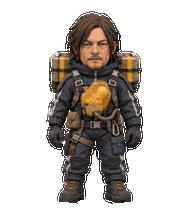
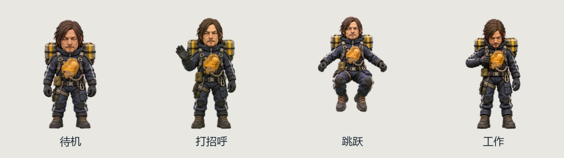

<!-- Author: 用户 -->

# 山姆 · ChatGPT 智能伙伴

以初代《死亡搁浅》的山姆·波特·布里吉斯为原型。深蓝送货服、琥珀色 BB 舱和背负货箱是他的识别特征。工作时检查胸前绑带，检查完轻轻点头。

> 寡言的送货员。话不多，路再难也会把货送到。

[观看完整动作预览（MP4）](preview/sam-motion.mp4)

## 下载与安装

| 文件 | 用途 |
| --- | --- |
| [sam-v2.png](assets/sam-v2.png) | 完整素材。1536 × 2288，含九种动作与十六个视线方向。 |
| [sam-v1.png](assets/sam-v1.png) | 兼容素材。1536 × 1872，保留九种动作。 |

使用支持 v2 的安装入口时选完整素材。网页以 1536 × 1872 为上传规格的入口请选兼容素材。入口因客户端和账号而异，见 [ChatGPT 智能伙伴官方说明](https://learn.chatgpt.com/docs/pets)。

两份素材均为透明 PNG，每格 192 × 208。v1 的前九行像素与 v2 一致。

本项目为同人创作。《死亡搁浅》及山姆角色的相关权利归各自权利方。[小岛工作室的游戏介绍](https://kojimaproductions.jp/en/death-stranding-dc)。
